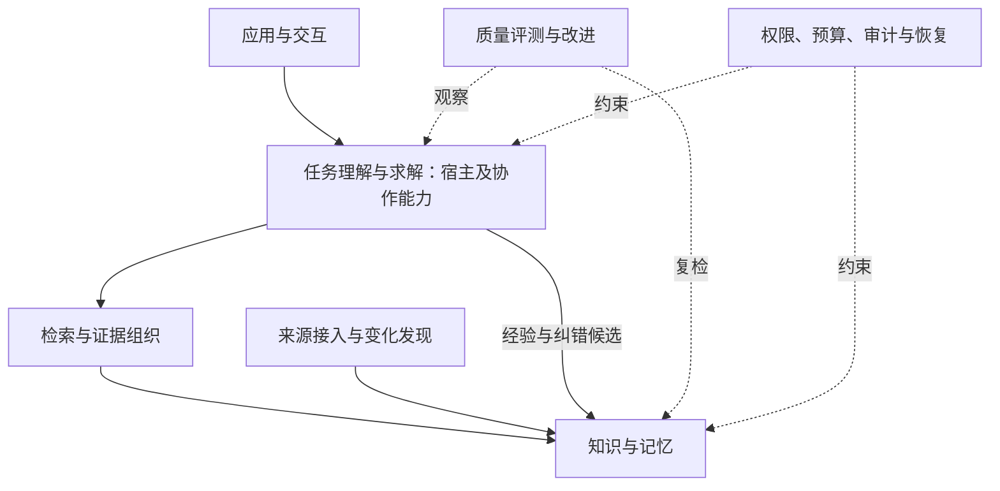

# 通用 Agent 知识基础设施：架构设计 v0.2

日期：2026-11-12。状态：纳入仓库文档的设计基线草案，供实现与人工审阅使用。
用户已确认总体方向与分层；具体机制须在对应任务中验证，不代表全部细节或代码交付已验收。

## 1. 目标和文档职责

帮助 Agent 更准确地理解目标、获取适用知识、建立有依据的关联、探索方案并核对结果，
通过纠错、知识复检和评测持续改进。能力应可跨自然语言、编程语言、业务和宿主复用，
以 MCP 等接口提供服务。改善的是知识、上下文和工作过程，不涉及训练基础模型。

- [工程初心](../PROJECT_PURPOSE.md)：保存价值目标，包括真实用途、成本与可持续收益。
- [能力路线图](capability-roadmap.md)：保存 C01—C09 完整方向、研究候选和长期缺口。
- 本文：保存当前架构职责、交付边界与设计取舍；后续修订记录理由和影响。
- [TASKS.md](../../TASKS.md) 与任务接续：保存当前实施范围、实际证据和人工审查状态。
- [协作技能决定](../tasks/ai-collaboration-skills-discussion-2026-11-12.md)：保存用户确认的载体取舍。

发生分歧时依据当前用户决定、项目约定和对应任务确认范围处理，不把设计草案当成覆盖权限的命令。
本地 `.verification/` 保存过程日志与旧草案，不作为同行理解本文的必需前提。

## 2. 五层职责与交付边界



| 层次 | 输入与输出 | 责任边界 |
|---|---|---|
| L1 来源接入 | 来源位置/范围 → 可定位内容、版本与变化信号 | 来源登记不等于内容已验证，不直接产生生效规则 |
| L2 知识与记忆 | 候选与审核决定 → 带来源、范围、版本和状态的知识及关系 | 不按相似度判定真假，不将全部聊天永久化 |
| L3 检索与证据 | 查询与约束 → 相关证据、缺口、冲突及降级信息 | 相关性通过不等于答案充分 |
| L4 理解与求解 | 用户目标、证据、工具观察 → 方案、动作请求和结果核对 | 当前主要由宿主承担；不替用户批准，不假装已执行 |
| L5 应用交互 | 用户输入/状态 → 标准请求、进度和结果展示 | 微信、小看板等通过公开接口使用核心 |

质量与改进、运行治理、接口与适配贯穿各层，通过明确接口工作。
这五层是逻辑职责，不要求部署五个服务。

交付时分别提供：知识核心、可选宿主协作、本项目治理及应用适配。
知识查询不要求消费者采用本项目整套 Contract/Harness；普通任务可用宿主任务身份。
本项目实现任务通过适配引用 Contract 身份/版本，仍遵守现有冻结、启动与人工交付规则。
“按需接入”不允许绕过知识有效性、授权和审核。

核心可在没有微信、小看板及通用终端执行器时独立提供服务。
后台来源监测可有受控调度，但不能依赖某次聊天在线，也不代表已经部署后台 Agent。

## 3. 数据与依赖

优先复用 SQLite 真源、本地 embedding/reranker、ES 派生索引和现有 MCP；以模块化单体起步。
没有实测瓶颈前，不引入新图数据库、微服务或通用工作流框架。

- 知识核心不依赖应用 UI、微信或特定 Android 业务对象。
- SQLite 保存知识与治理状态；索引、向量、摘要和缓存为可重建派生物。
- 模型、存储、来源连接器经适配边界接入；写操作由所属服务授权和处理。
- 图谱引用知识版本和来源，不保存另一份可独立修改的事实正文。
- 错误、空结果、冲突与降级分别表达；接口扩展保留兼容性和明确能力检查。

当前已有知识对象、来源版本、关系、契约、运行和检索元数据。
后续逐步补齐不可变修订历史、细化适用范围、统一证据集合与任务检查点；字段存在不代表完整语义已实现。

## 4. 原始检索流程

```text
离线：来源获取 → 解析/结构分块 → 父子关联 → BM25/向量双索引 → 就绪检查
在线：目标与约束 → 必要时预处理 → BM25 ∥ kNN → RRF → 本地重排
     → 相关性判断 → 不足时改写重检索（最多两轮）
     → 证据组织与适用性核对 → 宿主生成 → 要求覆盖/结果核对
```

当前 BM25/kNN 各取 40，RRF 合并 30，重排候选 20，默认返回 10；是当前配置，不是普适最优值。
应用层 RRF 是现有 ES Basic 适配。可选问题生成/摘要尚未实现，加入前须比较收益和成本。
图谱解释与影响查询已有基础，尚未接入 search 排序；不能据接口存在声称提升了关联检索。
改写和回答由宿主承担，固定改写协议测试不证明自主求解质量。

治理状态、来源核验、任务适用性、相关性、答案充分性分别判断。
`relevance_grade=pass` 仅表示候选相关；`answer_assessment=not_assessed` 表示平台未评估答案充分性。
宿主按原问逐项核对所需信息、对象/版本/时间、来源状态/冲突及关键结论原文。
信息缺失时部分回答、说明缺口或必要澄清，不补造网址、数值或执行结果。

临时外部证据可在权限内带来源用于本次任务，不必先成为长期知识；
组织规则与长期知识仍走审核。原文、转述、推断、用户明确要求分别标记。

内部资料不足不是整个任务的默认终点。宿主先识别缺口：缺决定性用户信息则澄清，
缺可查询事实则通过可用工具补充外部证据，需要环境证明则在授权内验证。
补证后重新核对原问、来源和版本；即使相关性 pass 但缺信息，也要继续这一判断。
只有证据仍不可得、依赖/权限受阻或预算耗尽时，才说明查证过程和停止原因。
待实施的具体文件与验收方案见 [T-031](../tasks/t-031.md)；目前不是已上线的自动外查闭环。

## 5. 任务状态、上下文与求解

工作过程：目标/更正 → 任务状态 → 有预算的上下文 → 选择下一步 → 实际观察 → 结果核对。
有关键缺口且预算允许时继续；停止原因区分已覆盖、缺证据、缺权限、依赖失败与预算用尽。

任务状态引用目标版本、确认事实、假设、未决问题、证据身份、检查点和下一步。
契约拥有本项目正式目标；摘要、会话与小看板只是视图，不能反过来修改批准范围。
用户更正后复查受影响步骤；已产生的外部效果如实说明。

上下文优先保留目标、硬约束、确认决定、关键证据和冲突。
深层资料按需读取；记录引用及截断范围。摘要带来源/版本，不能把未知、否定或条件压成确定事实。
容量不足时缩小步骤或明确缺口，不无限堆积历史。

简单且有据的问题直接处理；缺关键用户信息时澄清；缺事实时查证；机制不明且可验证时做小实验。
重要路线取舍比较效果、成本和失效条件。重复检索没有新增信息时收敛或换验证方式。
这些动作按任务需要采用，不强制额外模型调用、多 Agent 或固定研究轮次。
记录简短行动理由、观察和证据，不收集模型内部思维链。

可复用方法保存适用范围、环境前提、步骤、预期观察、失败分支及验证证据；方法本身不是执行许可。
知识图谱、任务步骤和结果证据分别管理，通过已有身份连接，避免每次调用都变成永久知识节点。

## 6. 更新、发布与恢复的八项边界

| 边界 | 设计要求与验收场景 |
|---|---|
| 身份与授权 | 本机白名单不等于远程认证。授权覆盖检索、全文、图谱、缓存、导出与后台任务；外部资料不能改变权限。连接器限制目标、重定向、文件与资源范围；测试伪造身份和越界路径 |
| 发布与回收 | 真源变更与待同步工作同事务落盘；消费幂等。受控发布者核对代次、效果与逐项错误，旧构建不得覆盖新版本；协调在建/当前/回退目标与回收，测试乱序、崩溃和响应丢失 |
| 消费时变化 | 检索有效不代表生成/执行时仍有效。最终发送及动作提交前复核依赖证据和权限；高影响内容先核对后发送，明确流式与跨系统竞态限制 |
| 删除与恢复 | 区分撤权、废弃、归档和删除，处理派生内容与备份保留。恢复到隔离环境，核对 schema、来源材料、配置、删除/撤权依据后再开放；旧备份不能默认恢复全部有效状态 |
| 临时证据 | 当前任务资料与长期生效知识分开；外部发现与规则冲突时提出复检候选，不静默覆盖规则，也不强制每次阅读都人工入库 |
| 历史版本 | 稳定 ID 与不可变修订分开，治理事件另记。区分当前有效、旧业务版本适用、历史决策引用；来源不可重现时说明限制，删除与许可优先 |
| 外部副作用 | 逻辑操作身份贯穿尝试；使用外部幂等键或效果查询。结果未知且无法对账时停止盲目重试。取消请求、执行器确认与最终效果分开，不承诺所有工具恰好执行一次 |
| 全程预算 | 子调用共享截止时间和重试/资源预算，改写轮数按逻辑问题累计；控制与工作队列都有容量和公平性，避免阻塞或饥饿 |

以上为待分期实现验证的要求，不能据本表声明已覆盖故障路径。
当前已有部分真源版本/摘要核验、备份完整性检查和治理状态检查；完整发布、恢复与隔离仍有缺口。
API A→B 的完整目标：发现变化 → 来源登记 → 影响查询 → 复检候选 → 验证审核 → 发布/索引同步 → 再查询。
旧版本仍适用的知识保留范围；检查失败、未监测与待复检不能显示为已更新。

## 7. 质量、改进和实际价值

先确定具体用户、任务与现有做法，比较要求覆盖、无依据断言、不必要追问、重复失败、恢复结果、
用户时间及运行/维护成本。持续使用和付费意愿需真实反馈，不由架构复杂度推断。

区分实现回归、任务效果和人工验收。候选改进先复现失败，保存具体反馈，再与基线比较。
开发案例与最终保留案例隔离；已反复看过的案例不能称独立盲测。
权限和已知失效单独判定，不用平均质量分数抵消。当前采用确定性检查和人工审查，模型裁判另需授权。

同一模型与语料下先分别验证任务状态、上下文组织及求解策略，再决定组合。
每项机制记录对应失败、使用条件、收益、成本和复审触发条件；收益消失或负担过高时简化/删除。
外部方案作为候选，只有隔离试点收益超过迁移维护成本时才考虑引入。

本地模型不等于零成本，宿主仍消耗 token/额度。查询、上下文、重试、历史、日志和备份有容量与保留策略。
具体预算根据实测确定，不填写未经验证的 SLA、提升比例或规模承诺。

## 8. 当前能力与下一步

| 已有基础 | 当前边界 |
|---|---|
| T-026/T-027 本地模型、分块与检索主干 | 可选富化、完整宿主闭环与广泛质量验证尚未齐全 |
| T-028 来源、依赖/替代、审核与影响查询 | 不是完整概念图谱、关联检索或自动来源监测 |
| T-029 接线与小型检索基线 | 公开合成案例、独立性有限，具体待审状态见任务 |
| T-030 答案边界与宿主约定 | 已有自动检查证据，人工待审；不是独立充分性判定器 |
| 微信/小看板 | 应用及故障实证来源，不作为知识核心完成证明 |

当前任务仍为 [T-030](../tasks/t-030.md)。后续实现建议先验证一个完整小场景，再用第二个领域检验通用性。
建议的下一任务是“目标—证据—回答核对的任务级基线”，具体设计如下，尚未创建运行或批准实施：

| 案例 | 必须看到的结果 |
|---|---|
| 目标明确且有完整依据 | 直接给答案和来源，不重复澄清已知信息 |
| 请求具体 URL，但资料没有 | 说明缺地址，不能因相关性通过就生成 URL |
| 询问离线模型检查方法 | 给适用前提、步骤、预期结果和失败处理；没执行不能报已验证 |
| 用户更正对象或版本 | 更新要求并核对受影响证据，不能继续使用旧目标结论 |

实施前限定文件职责：独立任务案例/标注、与现有评测分开的宿主输出记录、确定性引用核对、人工审阅材料。
复用现有评测与证据机制，不把人工语义判断包装为自动判定器。
在已有流程上先测基线，再选择一项候选改进；不预先迁移框架、改排序或新增后台模型调用。
当前阶段无需先实现统一任务引擎；完成案例和对照后再确定代码清单与验收阈值。

后续按证据补齐：知识更新试点 → 记忆/概念与关联收益 → 持续复检/改进 → 跨宿主可复用交付。
阶段次序按真实失败调整，C01—C09 完整目标继续保留，不把分期延期写成删除能力。

## 9. 参考与采用边界

以下原始资料于 2026-11-12 对照阅读，借鉴机制，不代表安装、运行或复制代码。
链接内容可变化，实际引入前固定版本并核对许可证、维护状态和运行成本。

| 来源 | 采用方向与边界 |
|---|---|
| [MCP 架构](https://modelcontextprotocol.io/docs/learn/architecture) | 明确宿主与服务边界；协议不保证宿主正确使用证据 |
| [W3C PROV-O](https://www.w3.org/TR/prov-o/)、[SKOS](https://www.w3.org/TR/skos-reference/) | 来源与概念身份参考，未实现完整标准，不预设 RDF 存储 |
| [LangGraph persistence](https://docs.langchain.com/oss/python/langgraph/persistence)、[interrupts](https://docs.langchain.com/oss/python/langgraph/interrupts) | 任务检查点/长期记忆分开；节点可能重跑，不能假设副作用自动去重 |
| [Letta MemFS](https://github.com/letta-ai/letta-docs-md/blob/main/concepts/memfs/index.md) | 常驻与按需上下文、版本化记忆；不替换 SQLite，不照搬自主改规则 |
| [STORM](https://github.com/stanford-oval/storm) | 问题驱动研究、证据组织与收敛；不强制长报告或多 Agent |
| [Graphiti](https://github.com/getzep/graphiti) | 来源、有效时间与历史关系；不直接采用自动失效判断或更换图数据库 |
| [DSPy/GEPA](https://github.com/stanfordnlp/dspy/blob/main/docs/docs/api/optimizers/GEPA/overview.md) | 反馈与候选实验；不默认训练、付费优化或模型裁判 |
| [LongMemEval](https://github.com/xiaowu0162/LongMemEval)、[V2](https://github.com/xiaowu0162/LongMemEval-V2) | 更新、时间、流程与环境前提的评测维度；未运行全量基准 |
| [AWS outbox](https://docs.aws.amazon.com/prescriptive-guidance/latest/cloud-design-patterns/transactional-outbox.html)、[ES aliases](https://www.elastic.co/docs/manage-data/data-store/aliases) | 双写/重试/顺序与发布结果核对；不要求引入消息中间件 |
| [SQLite backup](https://www.sqlite.org/backup.html)、[MCP 安全建议（draft）](https://modelcontextprotocol.io/docs/draft/tutorials/security/security_best_practices) | 区分数据库快照与完整恢复，明确认证/来源连接边界；非完整安全审计 |

协作方式继续维护现有规则，暂不独立建技能库；已撤回的 `gongjin-skills` 及三个技能不自动恢复。
只有方法经过真实使用且确有跨项目复用需求时，再讨论 skill 分发与版本同步。

## 10. 本次归档与验证限制

本文综合本会话 v0.1/v0.2、设计复查、项目对照和愿景回归；合并重复叙述，保留关键取舍与未验证项。
新增本文件并连接知识入口/路线图和当前任务接续；没有改变产品代码、契约或审核状态。
本轮无新增可复用知识提案：复用既有搜索与来源核对，本次是已讨论设计的正式归档，无新实验结论。
执行文档差异/链接检查，不以此前平台测试结果证明本轮文档或新增设计已通过行为验收。
正式审查或交付需匹配当前工作区指纹，不能沿用旧快照批准。
