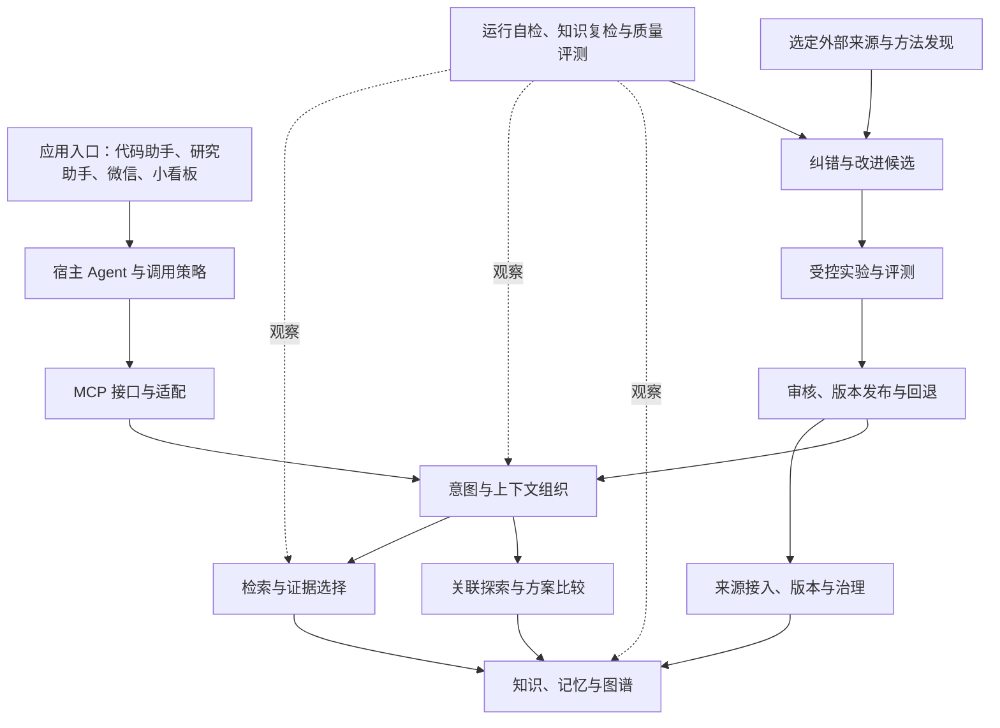

# 通用 Agent 基础能力总设计与路线图

当前职责与接口边界见[架构设计 v0.2](architecture-v0.2.md)。本路线图保存完整能力方向，
架构文档保存当前设计取舍，任务接续保存实际实施与证据，三者不互相冒充验收结论。

更新：2026-11-11。依据本轮及此前会话中的用户目标、修正与项目接续记录整理。

本轮实际实现与原设计的差距、优先纠偏顺序见[设计对照检查](design-alignment-2026-11-11.md)。

目标是让 Agent 更准确理解意图、持续积累知识、建立有依据的关联、探索方案，
并通过检测与评测改进表现，最终通过可插拔 MCP 接口服务不同模型和应用。
能力应跨自然语言、编程语言和业务领域；代码理解是应用场景之一。

本文保存完整方向与尚未实现的能力；[T-028](../tasks/t-028.md) 仅是来源与关系图谱的第一步。
未进入当前任务的内容继续保留，不代表取消；总体方向认可也不等于每个技术细节已经批准。
本文没有新增后台任务、自动模型调用或收费服务，不将研究方案的结果当作本项目效果。

## 1. 已确认的目标与约束

| 用户表达的诉求 | 设计要求 |
|---|---|
| 让 Agent 更聪明，理解语义、发散和关联 | 同时建设理解、记忆、检索、图谱、探索和评测，不能只交付一个搜索接口 |
| 基础设施跨语言、跨工程、跨业务 | 核心对象不用 Android/当前项目业务类绑定；自然语言与编程语言分别验收 |
| 尽量复用现有知识体系 | 延续 SQLite 真源、审核、检索、审计和备份；新增模块逐步接入 |
| 知识会过期，例如 API A 变成 API B | 管理来源版本、适用范围、替代和依赖，并能主动复检已接入来源 |
| 希望自检测、自进步、同步先进方案 | 建设发现问题—提出候选—实验—评测—审核—发布—监测的闭环 |
| 控制费用、token、磁盘与维护负担 | 本地模型优先；查询、上下文、重试和存储有预算；收益须与资源开销一起衡量 |
| 最终成为可插拔 MCP | 将稳定核心与模型、存储、入口适配分开；兼容性与真实调用需要测试 |
| 远程操作属于应用，不应算基础设施能力 | 微信、小看板和其他入口通过接口使用核心；不以渠道连通冒充认知能力进步 |
| 借鉴方案应标明来源 | 记录思想参考、代码/模型/数据复用、版本、许可证和本项目改动，区分各类义务 |

设计不能承诺改变基础模型的权重或智力上限。当前可改善的是可用知识、上下文、检索、
工具使用流程和反馈质量；训练模型是另一项需要数据、成本和独立评测的工作。

## 2. 完整能力地图

下面的 C01—C09 是长期稳定的能力编号。之后任务应标注推进了哪些能力，不以任务名称替代总目标。

| 编号 | 能力 | 完整目标 | 当前基础 | 主要缺口 |
|---|---|---|---|---|
| C01 | 知识接入与治理 | 文档、代码、网页、经验等接入；解析、去重、来源、版本、许可和生命周期 | 知识提案/审核/废弃、时效、纯文本/Markdown 分块 | 来源同步、PDF/OCR、内容修订历史、来源版本登记 |
| C02 | 语义与意图理解 | 识别目标、约束、指代、歧义、隐含假设和概念；跨语言对齐 | 契约保存显式目标和验收，当前模型参与理解 | 通用意图结构、术语消歧、意图纠正、跨语言评测 |
| C03 | 分层记忆 | 当前任务、用户偏好、领域事实、经历和方法分别保存；支持纠正、遗忘和跨会话接续 | 知识库、任务记录、契约与审计 | 统一记忆生命周期、偏好适用范围、遗忘与隔离机制 |
| C04 | 检索与上下文组织 | 多路召回、重排、证据判断、改写、去冗余、上下文预算与可引用回答 | T-027 检索主干、来源片段及重试状态 | 自动对话闭环验收、阈值校准、上下文装配、答案证据覆盖 |
| C05 | 图谱与关联 | 概念、事实、来源、决策、依赖和冲突相连；可解释的多跳查询 | 检索块父子关系；T-028 已实现来源/依赖/替代与审核查询，验收见任务记录 | 概念层、支持/反驳、类比关联及质量评测 |
| C06 | 发散与方案比较 | 生成不同路线、跨领域类比、寻找反例、约束筛选、比较成本与可行性 | 依赖当前会话模型和人工判断 | 稳定探索流程、差异性检查、方案验证、可复用案例 |
| C07 | 自检测与知识复检 | 检测运行异常、知识陈旧/冲突、检索退化和理解偏差；定位原因 | 本地模型/ES 健康检查、自动测试、时效检查 | 来源监测、语义复检、影响传播、质量漂移和提醒 |
| C08 | 反馈、外部学习与持续改进 | 记录错误、发现先进方案、验证适用性、比较效果、审核发布和回退 | 经验提案、审核、证据与任务流程 | 案例集、固定评测与保留集、候选实验、版本化策略和持续监测 |
| C09 | 可插拔接入与运行治理 | MCP、模型/存储适配、权限与空间隔离、资源预算、恢复、可观测性 | 本机 MCP、审计、备份、受控任务流程 | 多空间隔离、可靠远程认证、长运行恢复和完整成本观测 |

“当前模型能在对话中做”与“基础设施已实现并验证”分别记录；不能把模型的一次良好回答当成模块已完成。
T-029 新增公开合成案例的双后端检索基线，数据与标注仍待人工审查；
具体质量差距见[报告](../metrics/retrieval-quality-v1.md)，不代表全部能力已经提升。
T-027 最近平台检查为 139 passed，证明对应实现通过测试，不证明上述九项能力已经齐全。
证据见 [T-027](../tasks/t-027.md) 和 `.verification/t027-resume-20261111/review.md`。

## 3. 分层架构与职责



权限、空间、审计、预算和备份横跨各层。核心不依赖微信或某个桌面客户端。
MCP 提供上下文与工具交换，宿主决定何时调用以及如何使用结果；接上 MCP 不自动获得持续运行、
主动学习或完整记忆。后台复检需要独立调度与明确运行策略，不能依赖一次聊天连接的寿命。
依据：[MCP 官方架构](https://modelcontextprotocol.io/docs/learn/architecture)。

## 4. 必须保留的检索流程

原始要求保留为完整目标：

```text
离线：解析 → 结构分块 → 父子关联 → BM25/向量双索引 → 可选问题生成/摘要
在线：Query → 可选预处理 → BM25 ∥ kNN → RRF → Cross-Encoder 重排
     → 相关性判定 → 不足时改写并重检索（≤2轮）→ 证据组织 → 带来源生成
```

- 当前召回配置：BM25/kNN 各取前 40，应用层 RRF 合并取前 30，本地重排前 20，默认返回 10。
  这些是当前实现参数，后续根据评测调整，不当作所有领域的固定最优值。
- 当前 Markdown/纯文本摄取、模型缓存、离线模型和检索主干已有检查证据。
  ES Basic 下采用应用层 RRF；原图可选的 generated questions/summary 尚未实现。
- 改写与回答仍由当前会话负责。协议测试使用固定改写句，尚不能证明自主改写—生成闭环。
- 当前聊天 MCP 曾仍走降级路径；新进程集成成功不等于已有宿主连接配置已更新。
- 未来图谱增加关系证据召回与解释，需验证其对事实检索的影响，不能无条件挤掉原始证据。
- 上下文装配还要去重复、保留冲突、附版本/时效/适用范围，并限制注入 token。
  没有足够证据时，应说明缺口或提出澄清，不把相似度分数当事实正确概率。

## 5. 理解、记忆与发散的具体设计方向

### 5.1 理解用户在解决什么问题

保存目标、对象、约束、成功条件、已确认决定和未决问题，并关联原始依据。
区分用户明确要求、模型推断、外部陈述；推断可纠正，不能悄悄升级成用户偏好。
处理“这个/刚刚/继续”等跨轮指代；发现与旧决定矛盾时先比较适用范围与时间。
跨语言概念使用稳定标识，分别记录名称、别名和语言；不同工程的同名术语不能自动合并。

代码理解扩展包括符号、调用/依赖、测试与变更影响，可按语言接入解析器。
不能声称单一文本向量模型已经理解所有编程语言；非代码领域使用自己的概念和证据适配。

### 5.2 让记忆有层次、边界和纠错方式

区分工作记忆（当前任务）、长期事实、用户偏好、经历案例和可复用方法。
记住决定及理由、适用范围和验证证据，不默认保存全部聊天和冗长日志。
用户纠正触发相关记忆复检；新偏好不应无条件覆盖另一项目中的旧偏好。
支持显式撤销/删除、按价值归档，以及删除后派生索引同步处理；保留政策需明确备份中的处理方式。
多项目使用前建设空间隔离与显式共享，不能把当前单库的标签当权限隔离。

### 5.3 发散要能产生并检验不同方案

流程方向：重述问题与约束 → 查相关案例 → 生成有实质差异的路线 → 寻找反例与失效条件
→ 比较成本/收益/实现难度 → 选择小实验 → 保留决定及理由。
类比必须指出相似结构与不成立的条件；共同出现不证明因果，模型补出的关系只能作为候选。
避免把相同方案换词后算多条路线，也避免为简单任务强制多 Agent 或固定大流程。
过度编程检测关注无需求支撑的抽象、依赖、重复实现和维护负担；不能只奖励代码量少或测试数量多。

## 6. 完整图谱目标与 T-028 的位置

完整图谱逐步覆盖：概念、可核对的事实陈述、来源版本、知识条目、任务/决策、经验/评测案例。
模型输出的推测独立标记，保留产生依据；图上有边不代表该边已经被验证。

| 关系家族 | 要解决的问题 | 当前计划 |
|---|---|---|
| 派生/引用 | 知识来自哪里，引用哪个版本 | T-028 的 derived_from 与证据引用 |
| 依赖/替代 | 什么受影响，新旧知识怎样关联 | T-028 的 depends_on、supersedes |
| 支持/反驳/冲突 | 哪些证据支持结论，分歧在哪里 | 后续；需要定义证据强度与适用条件 |
| 同义/别名/上下位 | 不同说法是否同一概念，概念如何组织 | 后续概念层与跨语言评测 |
| 类比/相关 | 能否从别的领域借用方法 | 后续探索候选；不能直接当事实推理边 |
| 决策/验证 | 为什么采用某方案，什么结果支持它 | 后续连接现有契约、案例和评测证据 |

每条边需要来源、端点版本、时间、适用条件、确认状态；必要时保留不确定性的理由。
第一版采用有界遍历避免循环与返回膨胀；以后是否引入专用图数据库由规模和查询证据决定。
图形展示作为查看与审核应用保留在路线中，但图谱是否成立由数据语义、查询和证据决定。

T-028 本轮已实现“来源版本 + 三种关系 + 人工审核 + explain/impact”，检查与人工审查状态见任务记录；
它对 C01/C05/C07/C09 有局部贡献，不完成语义理解、长期记忆、自动复检或自主进步。

## 7. 自检测、自更新、自进步、自同步分别做什么

| 能力 | 输入与输出 | 重要边界 |
|---|---|---|
| 运行自检测 | 模型、索引、服务、队列、磁盘、权限状态 → 可解释诊断 | 进程存活不等于整个链路可用；降级需要显式说明 |
| 知识复检 | 来源变化、检查期限、用户纠错、冲突 → 待复检项与影响路径 | 内容变化不等于知识失效；检查失败不标为已更新 |
| 知识自更新 | 差异与证据 → 新版本/替代关系候选 → 审核发布 | 保留旧版本适用范围，不自动覆盖旧结论 |
| 方法自进步 | 失败案例与指标 → 改进候选 → 对照实验 → 发布或拒绝 | 单次成功或模型自评不足以证明提升 |
| 外部方案同步 | 选定官方文档、发布记录、论文/仓库 → 去重与适用性评估 | 发布新版本不自动升级依赖，不默认运行外部代码 |

API A → B 的完整目标：监测已接入来源 → 登记变化 → 找依赖 → 提示复检 →
生成候选与适用范围 → 验证 → 人工批准 → 更新有效知识及索引 → 监测回归。
T-028 只打通登记和影响追溯；自动发现、任务调度与语义验证仍属于后续。
没有接入的来源明确为“未监测”；定时任务报告最后成功检查时间、失败与积压。

## 8. 评测与持续改进闭环

评测从第一阶段就建立，之后随能力增加案例。区分实现回归、系统质量、真实任务收益。
保留集不用于反复调优；模型评审可作为未来辅助选项，当前默认人工审查规则保持不变。

| 评测面 | 代表案例与指标 |
|---|---|
| 理解 | 指代、多义词、目标变更；目标/约束提取正确性、必要澄清与误判 |
| 记忆 | 跨会话决定、偏好纠正、时间变化；正确召回、错误记忆与遗忘行为 |
| 检索/回答 | 同义表达、中文/英文、无答案、冲突证据；召回、排序、来源覆盖与无依据回答 |
| 图谱 | 多跳证据、替代条件、依赖方向、循环；路径正确性、影响漏报/误报与截断 |
| 发散 | 不同领域问题；方案差异、可行性、反例质量和实际验证收益 |
| 更新 | API 与非代码流程更新；发现延迟、误判过期、候选审核与回退 |
| 工程与成本 | 故障恢复、备份、隔离；延迟、token、调用次数、磁盘增长、重复失败率 |

建设机制：收集纠错 → 脱敏成案例 → 复现失败 → 提出一项可解释改动 → 与基线比较
→ 检查保留集和成本 → 人工审查 → 版本发布 → 监测与回退。
新增测试数量、图谱节点数、文档数量都不能单独作为“更聪明”的指标。

## 9. 成本、存储与维护

本地 embedding/reranker 固定模型修订与文件摘要；缓存预热后验证离线可用。
现有模型偏中文，跨语言质量需要另测；更换模型前比较效果、内存、磁盘与重建成本。
当前无新增付费 LLM API；由宿主模型改写/生成仍可能消耗宿主的 token/额度，不能称零成本。

查询和探索设深度、候选数、重试、超时与 token 预算；稳定结果可缓存但需按内容/模型版本失效。
真源正文尽量单份保存；图关系引用 ID/版本/摘要；向量和全文索引作为可重建派生物。
来源相同内容去重；活跃知识与归档历史分开；备份和事件日志需要容量与保留策略。
清理前检查审计、引用和恢复需要，不因“旧”而删除仍被旧版本项目依赖的内容。
当前已有部分 ES 孤儿索引清理；备份保留、历史压缩与长期增长验证尚未完成。

## 10. 研究参考与采用登记

以下汇总此前讨论及图谱设计引用。链接用于定位原始资料；“评估方向”是我们想借鉴的部分，
不是宣布已经引入该项目。论文、代码、模型和数据集的使用许可分别核查。

| 来源 | 对应评估方向 | 采用状态 |
|---|---|---|
| [W3C PROV-O](https://www.w3.org/TR/prov-o/) | 来源、派生与责任主体，C01/C05 | T-028 拟借鉴思想，未实现完整标准 |
| [W3C SKOS](https://www.w3.org/TR/skos-reference/) | 多语言概念名称与关系，C02/C05 | 后续概念层参考 |
| [HippoRAG 2](https://arxiv.org/abs/2502.14802) | 事实检索与关联记忆兼顾，C04/C05 | 研究参考，未引入算法或代码 |
| [STORM](https://github.com/stanford-oval/storm) | 研究与带引用的知识组织，C06 | 候选，尚未验证本项目收益 |
| [Scideator](https://arxiv.org/abs/2409.14634) | 研究创意探索，C06 | 保留候选，需进一步核对方法与适用性 |
| [Memora](https://www.microsoft.com/en-us/research/blog/memora-a-harmonic-memory-representation-balancing-abstraction-and-specificity/) | 记忆抽象与具体信息的平衡，C03 | 保留候选，未引入 |
| [ACE](https://arxiv.org/abs/2510.04618) | 累积、修正与组织上下文经验，C03/C08 | 研究参考，未引入框架；关注摘要反复改写丢失细节 |
| [GEPA / DSPy](https://dspy.ai/current/tutorials/gepa_ai_program/) | 反馈驱动的候选优化，C08 | 候选，启用前确认模型成本和评测隔离 |
| [LongMemEval](https://arxiv.org/abs/2410.10813) | 信息提取、跨会话/时间推理、知识更新与拒答评测，C03/C08 | 可借鉴案例维度；未运行该基准 |
| [Anthropic Agent 评测说明](https://www.anthropic.com/research/demystifying-evals-for-ai-agents) | 系统评测设计，C08 | 参考；不改变当前人工审查规则 |
| [Phoenix](https://github.com/Arize-ai/phoenix) | 可观测性与评测工具候选，C07/C09 | 未安装，不预设必须引入 |
| [Agent Lightning](https://www.microsoft.com/en-us/research/project/agent-lightning/) | Agent 优化/训练方向，C08 | 远期研究候选，训练不属于当前范围 |
| [AlphaEvolve](https://deepmind.google/blog/alphaevolve-a-gemini-powered-coding-agent-for-designing-advanced-algorithms/) | 候选生成与验证循环，C08 | 研究参考，不将特定领域成果外推到本项目 |
| [arXiv RSS](https://info.arxiv.org/help/rss.html)、[Renovate](https://docs.renovatebot.com/) | 外部发现和依赖更新流程参考，C08/C09 | 未启用订阅或自动升级 |
| [MCP](https://modelcontextprotocol.io/docs/learn/architecture) | 稳定上下文与工具接口，C09 | 已有本机实现；通用能力插件仍在建设 |

参考登记至少包含：原始链接、版本/日期、借鉴点、是否复制代码/文字/图、许可证、涉及文件和验证结果。
README 保持简要致谢；详细映射放设计记录；实际复用按许可保留版权、许可和适用 NOTICE。
当前表是设计参考清单，不是整个仓库已完成的依赖/许可审计。

## 11. 分阶段建设与退出条件

阶段顺序为建议，未将后续各阶段自动创建为已批准实现任务；质量评测与成本记录贯穿全过程。

| 阶段 | 交付能力 | 可检查的退出条件 |
|---|---|---|
| A 可靠检索基线 | 收口 T-026/T-027；补代表性质量案例 | 离线与真实链路证据齐全；明确降级；区分自动检查和人工验收 |
| B 来源与关系 | T-028 来源版本、依赖/替代与证据路径 | 两类业务例子可追溯、可查询影响、可审核/撤销；旧库备份不丢失 |
| C 理解与记忆 | 意图结构、概念对齐、分层记忆、上下文组织 | 更正与跨会话/跨语言案例可复现；空间边界明确 |
| D 关联与探索 | 支持/冲突、多跳关联、跨领域类比和方案比较 | 路径有证据、反例可说明；关联收益不以事实检索退化为代价 |
| E 主动复检与同步 | 选定来源监测、变更登记、语义复检、影响任务 | 能区分已检查/失败/未覆盖；API A/B 和非代码更新场景完整闭环 |
| F 可验证的改进 | 失败案例、候选实验、版本发布与回退 | 保留集与成本对照通过；人工可查看改动依据和回退效果 |
| G 可复用 MCP 交付 | 模块化配置、模型/存储适配、可靠接入与隔离 | 在不同宿主和至少一个不同领域验证；安装/恢复/权限路径可复现 |

MCP 已有接口可贯穿各阶段使用；G 是可复用交付的验收，不意味着前面不能使用 MCP。
PDF/OCR、图形浏览、多 Agent、训练等按具体需要再排期，不作为基础能力完成的默认前置条件。

## 12. 后续维护方式

- 总设计保存完整能力与未完成方向；任务文档保存本次文件、范围和证据；实现说明只记录真实行为。
- 每个新任务标明 C 编号、解决的用户场景、验收方式、明确延后但仍保留的能力。
- 缩小一次实现范围时更新对应任务，不删除总体能力；取消长期目标须记录用户决定及原因。
- 本次整理仅新增本文，并在知识入口、T-028 与任务索引建立链接；没有改变契约范围或批准状态。
- 本轮无新增可复用经验提案：内容是既有讨论与未验证方案的归档，避免将设计愿景当成生效规则。
